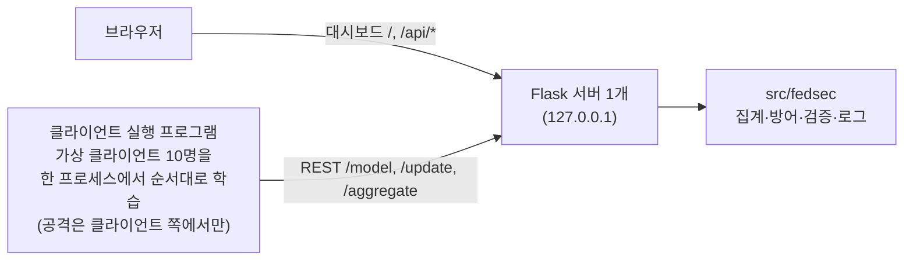

# websys-project-fedsec

> 2026-2 웹기반 시스템 · Project 5
> **연합학습 보안 시뮬레이션 및 공격·방어 결과의 원인 분석**

Flask·REST API로 연합학습(FedAvg) 시뮬레이터를 만들고, 그 위에서 두 가지 공격과 방어를 실험했습니다.

- **내부자 협력 공격:** 악성 클라이언트 2명이 정상 업데이트 평균 × (−5)를 제출 → 노름 클리핑, 좌표별 중앙값으로 방어
- **모델 역추적 공격(DLG):** 그래디언트에서 학습 이미지를 복원 → 가우시안 노이즈로 방어
- 운영 환경 4개(기준, 지연, 부분 참여, 레이블 편향)에서 비교하고, 저장된 모델에서 조건 하나만 바꾼 재실험으로 원인을 확인

---

## 핵심 결과

**내부자 협력 공격** — 최종 테스트 정확도 (%, 시드 0·1·2 평균, CIFAR-10, 40라운드)

| 환경 | 정상 FedAvg | 공격 + FedAvg | 공격 + 클리핑 | 공격 + 중앙값 |
|---|---|---|---|---|
| 기준 | 76.22 | 발산 (11\~17라운드) | 67.46 | **69.15** |
| 지연 (3명 마감 초과) | 73.49 | 발산 (6\~8라운드) | 58.91 | **61.55** |
| 부분 참여 (10명 중 5명) | 75.41 | 발산 (8\~17라운드) | 65.86 | **66.70** |
| 레이블 편향 | 74.17 | 발산 (4\~6라운드) | 59.68 | **60.74** |

- 방어 없이는 모든 환경에서 학습이 무너지고, 방어를 써도 정상보다 7\~15%p 낮습니다.
- 평균으로는 중앙값이 모든 환경에서 클리핑보다 높았습니다 (부분 참여·레이블 편향은 시드마다 엇갈림). 정상 환경에서 방어 때문에 잃는 정확도는 시드별로 1%p 미만입니다.

**모델 역추적(DLG)** — 노이즈 σ별 복원 오차(MSE, 클수록 복원 실패)

| σ | 0 | 1e-2 | 3e-2 | 1e-1 |
|---|---|---|---|---|
| MSE | 0.00005 이하 (그대로 복원) | 0.04\~0.08 (형체 남음) | 0.22\~0.24 (형체 사라짐) | 0.26\~0.31 |

- 정답 레이블은 σ 1e-1에서도 모두 새어 나갔습니다.

**방어 권고**
1. 내부자 공모가 의심되고, 특히 참여가 줄어드는 환경에서는 **좌표별 중앙값**을 씁니다.
2. 그래디언트를 공유하면 전송 전 **σ 3e-2 이상**의 노이즈를 넣고, 레이블 보호는 별도로 합니다.

자세한 숫자는 [비교표](experiments/4_main/_tables/comparison.md), 원인 분석 3건과 권고의 근거·한계는 [원인분석.md](reports/analysis/원인분석.md)에 있습니다.

---

## 빠르게 실행하기

```bash
git clone https://github.com/eseungq/websys-project-fedsec.git
cd websys-project-fedsec
python3 -m venv .venv && source .venv/bin/activate
pip install -e ".[test]"
pytest -q                     # 설치 확인
python web/app.py             # 대시보드 → http://127.0.0.1:8765/
```

- CIFAR-10은 [data/README.md](data/README.md)대로 `data/`에 받아 둡니다. 명령은 모두 레포 루트에서 실행합니다.
- 대시보드 화면 구성은 아래 [대시보드](#대시보드)에 있습니다.
- 실험 1회, 본 실험 72회, 재실행, DLG 명령은 [설치·실행 설명서](docs/manuals/install.md)에 있습니다.
- 폴더 이름에 한글이 있으므로 처음 한 번 `git config --global core.precomposeunicode true`와 `git config --global core.quotepath false`를 해 둡니다.

---

## 대시보드

```bash
python web/app.py      # → http://127.0.0.1:8765/
```

실험 결과를 그래프와 표로 보는 웹 화면입니다. 연합학습 서버와 같은 주소·포트에서 함께 뜹니다.

**화면 구성**

| 위치 | 내용 |
|---|---|
| 맨 위 | 모드 전환 버튼: **조회형**(저장된 결과 보기) / **실행형**(직접 돌려 보기) |
| 왼쪽 | 조회형이면 실험 결과 목록(묶음별로 거르기), 실행형이면 실험 조건 고르기 |
| 가운데 위 | 요약 4칸: 최종 정확도, 선택·채택·지연 수, 채택된 악성 비율, 실행 요약 |
| 가운데 | 클라이언트 10명의 마지막 라운드 상태 (채택·악성·지연·제외) |
| 아래 탭 | ① 학습·참여 추이 ② 클라이언트별 ③ 모델 역추적(DLG) ④ 환경·방어 비교표 ⑤ 재실행 결과 |

**이렇게 써 보세요**
- **본 실험 결과 보기:** 조회형 → 왼쪽 목록에서 `4_main`을 고르고 실행 하나 클릭 → ① 탭에서 라운드별 정확도 그래프 확인
- **공격과 방어 비교:** ④ 탭에서 환경별 공격 피해·방어 개선·정상 손실(%p) 확인
- **원인 분석 재실험 보기:** `6_replay` 묶음에서 실행을 고르면, ⑤ 탭에 원래 실행·시작 라운드·바꾼 조건이 나옵니다
- **DLG 복원 결과:** ③ 탭에서 실험을 고르면 원본과 노이즈 σ별 복원 이미지, MSE가 나란히 나옵니다
- **발표 시연:** 실행형 → 환경·공격·집계를 고르고 라운드 3\~5로 시작 → 라운드가 끝날 때마다 그래프와 클라이언트 상태가 갱신됩니다

실행형은 한 번에 하나만 돌릴 수 있고, 결과는 `experiments/live/`에 남습니다(커밋하지 않음). 파일별 역할은 [web/README.md](web/README.md), 주소별 응답은 [API 설명서](docs/manuals/api.md)에 있습니다.

---

## 시스템 구조



- 중앙 Flask 서버 1개와 가상 클라이언트 10명이 같은 PC의 localhost에서 REST API로 통신합니다.
- 네트워크 지연은 실제 네트워크가 아니라 **가상 시간**으로 판정합니다.
- 대시보드도 같은 서버·같은 포트에서 뜹니다. 방어 함수와 서버는 악성 ID를 모릅니다.

---

## 실험 설계

| 환경 | 기준에서 바꾼 한 가지 |
|---|---|
| 기준 | 참여 100%, 지연 없음, 클래스 분포가 비슷한 데이터 |
| 지연 | 고정된 3명이 가상 마감 시각을 넘김 |
| 부분 참여 | 라운드마다 10명 중 5명 무작위 선택 |
| 레이블 편향 | 같은 데이터의 클라이언트 배정만 바꿈 (표본 수 유지) |

- 환경마다 {정상, 내부자 공격} × {FedAvg, 클리핑, 중앙값}을 시드 3개로 반복합니다 (72회). 같은 환경·시드는 초기 모델·분할·악성·참여·지연 일정이 같습니다.
- 지표 (같은 환경·시드의 최종 테스트 정확도, %p)
  - 공격 피해 = 정상 FedAvg − 공격 FedAvg
  - 방어 개선 = 공격 + 방어 − 공격 FedAvg
  - 정상 손실 = 정상 FedAvg − 정상 + 방어
- 그 밖에 클래스별·클라이언트별 성능, 선택·채택·지연 제외 수, 실제 채택된 악성 비율, 가상 경과 시간과 실제 실행 시간을 기록합니다.
- DLG는 학습 실험과 따로, 같은 이미지·모델·복원 초기값에서 노이즈만 바꿔 비교합니다.
- 실행 환경: Mac의 Apple MPS (DLG는 CPU). 실행마다 기기·torch 버전·커밋을 `env.json`에 남깁니다.

---

## 단계별 진행

| 단계 | 한 일 | 문서 | 실험 결과 |
|---|---|---|---|
| 1. 기본 학습·데이터 준비 | 모델·학습 설정 탐색, 클라이언트 10명 분할 | [1_학습설정-결과.md](docs/stages/1_학습설정-결과.md) | [`1_setup/`](experiments/1_setup/) |
| 2. 연합학습 환경 | Flask 서버 1개 + 가상 클라이언트 10명, REST API, 제출 검증 | [2_서버-API.md](docs/stages/2_서버-API.md) | |
| 3. 공격과 방어 | 내부자 협력 공격(−5배), 클리핑·중앙값, DLG와 노이즈 방어 | [3_공격-방어.md](docs/stages/3_공격-방어.md), [3_DLG-결과.md](docs/stages/3_DLG-결과.md) | [`3_clip_threshold/`](experiments/3_clip_threshold/), [`3_dlg/`](experiments/3_dlg/) |
| 4. 운영 환경별 비교 | 환경 4 × 정상·공격 × 집계 3 × 시드 3 = 72회 | [4_운영환경.md](docs/stages/4_운영환경.md) | [`4_main/`](experiments/4_main/) |
| 5. 로그 수집·평가 | 학습·복원 로그, 모델 저장, 지표 계산, 재실행 도구 | [5_로그-평가.md](docs/stages/5_로그-평가.md) | |
| 6. 원인 분석 | 사례 3건(공격·방어, 운영 환경, DLG), 방어 권고 2건 | [원인분석.md](reports/analysis/원인분석.md) | [`6_replay/`](experiments/6_replay/) |

단계별 요약은 [docs/stages/README.md](docs/stages/README.md)에 모아 두었습니다.

---

## 폴더 구조

```
src/fedsec/     실험 엔진 (데이터·모델·클라이언트·집계·공격·방어·환경·서버·로그)
web/            Flask 웹 서버와 대시보드 (python web/app.py)
scripts/        실행 스크립트 (실험 1회, 본 실험 72회, 재실행, DLG, 비교표)
configs/        학습·공격·방어·DLG 설정, 환경 4개, 데이터 분할
experiments/    실험 결과 (폴더 앞 번호 = 명세 단계)
                1_setup/  3_clip_threshold/  3_dlg/  4_main/  4_main_repeat/  6_replay/
reports/        원인 분석·방어 권고, 그래프, 발표자료
docs/           단계별 문서(stages/), 설명서(manuals/), 통합 기록, 협업 규칙
tests/  tools/  테스트, 학습 설정 탐색 도구
members/        조원별 원래 구현 (근거 보관)
```

## 문서 안내

| 문서 | 내용 |
|---|---|
| [설치·실행](docs/manuals/install.md), [API](docs/manuals/api.md), [입력 파일](docs/manuals/input_files.md) | 설명서 |
| [scripts/README.md](scripts/README.md), [experiments/README.md](experiments/README.md), [web/README.md](web/README.md) | 스크립트·결과 파일·웹 파일별 설명 |
| [docs/통합.md](docs/통합.md) | 11/24 조원별 구현에서 모듈별로 골라 대표 코드로 합친 기록 (엔진·DLG: 이승규, 재실행 방식: 배병욱 PR #9, 대시보드: 안태현 PR #8) |
| [docs/협업규칙.md](docs/협업규칙.md) | 커밋·브랜치·PR 규칙 전체 |

---

## 확장 방향

1. **두 결과의 관계 분석:** 내부자 협력 공격과 모델 역추적의 결과를 함께 분석합니다. 구체적인 방법은 추후 결정합니다.
2. **D3 시각화:** 보고서를 쓴 뒤, 실험 결과를 D3로 시각화합니다.

## 남은 일정

> 제출: **12월 10일**

| 날짜 | 할 일 |
|---|---|
| 11/26 (목) | 실험 결과 확인, 보고서 작성 |
| 12/1 (화) | 보고서 수정·완성, 필요하면 PPT |
| 12/3 (목), 12/8 (화) | 못한 것 마무리 |
| 12/10 | 제출 |

## 팀 작업

- **커밋:** `<타입>: <제목>` (타입은 `feat`·`fix`·`docs`·`refactor`·`test`·`exp`·`chore`), 본문은 바꾼 파일 아래 `*` 목록. 한국어로 쓰고 `Co-Authored-By`는 넣지 않습니다.
- **브랜치·PR:** `feat/…`, `fix/…`, `docs/…`, `exp/…` 브랜치에서 작업 → PR → 리뷰 1명 승인 → **Create a merge commit**으로 머지
- **커밋하지 않는 것:** CIFAR-10 데이터, 모델 파일(`*.pt`, 원인 분석 출발 모델 12개만 예외), 원시 로그, 과제 명세 PDF
- **실험:** 본 실험은 커밋된 코드로 돌리고 결과에 커밋 ID를 남깁니다.

전체 규칙과 예시, 충돌 해결 방법은 [docs/협업규칙.md](docs/협업규칙.md)에 있습니다.

## 참고 자료

- FedAvg: McMahan et al., *Communication-Efficient Learning of Deep Networks from Decentralized Data*, AISTATS 2017
- DLG: Zhu et al., *Deep Leakage from Gradients*, NeurIPS 2019 · 공개 구현 [mit-han-lab/dlg](https://github.com/mit-han-lab/dlg)
- Kairouz et al., *Advances and Open Problems in Federated Learning*
- 공개 코드의 출처와 수정 사항: [FedAvg·서버](docs/stages/2_서버-API.md#공개-코드-출처와-달라진-점), [DLG](docs/stages/3_DLG-결과.md#공개-코드-출처와-달라진-점), 대시보드([web/LICENSE-dashboard](web/LICENSE-dashboard))
- 전체 목록과 요약: [docs/references/](docs/references/README.md)
