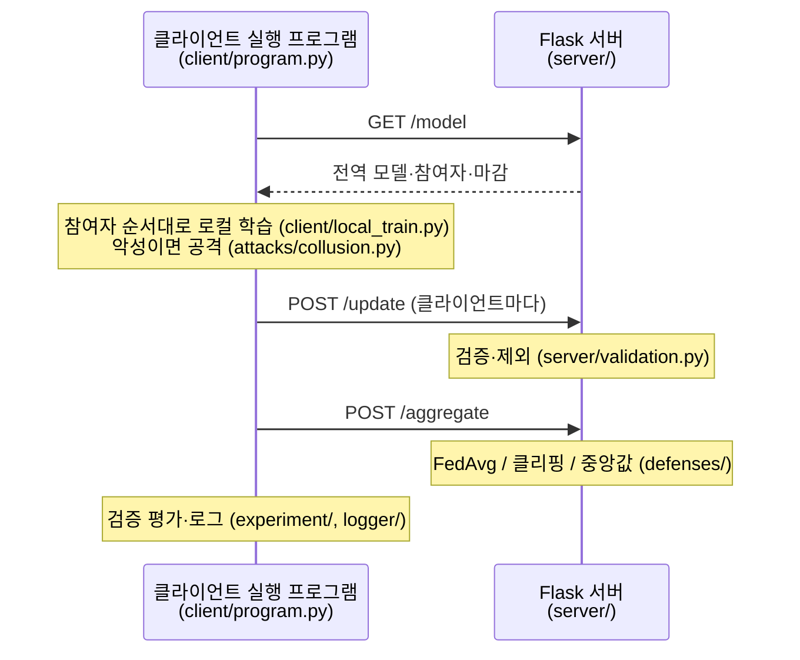

# 명세 단계별 문서

명세 1\~5단계의 구현 내용·결과·한계를 단계마다 적은 문서입니다. 6단계 원인 분석은 [reports/analysis/원인분석.md](../../reports/analysis/원인분석.md)에 있습니다.

**현재 상태 (11/24):** 명세 1\~6단계 모두 끝. 남은 것은 정량 평가 보고서 정리와 발표자료입니다.

## 명세 단계별 요약
단계마다 구현 내용과 결과를 짧게 적고, 자세한 내용은 문서로 연결합니다. 문서는 명세 문장을 그대로 제목으로 두고 그 아래에 "구현 내용 / 결과"를 적었습니다.

### 1. 기본 학습 실행 및 데이터 준비 → [1_학습설정-결과.md](1_학습설정-결과.md)
- **구현 내용:** CIFAR-10으로 기본 FedAvg 실행. 모델 `simple_cnn`(합성곱 3층 + 완전연결 2층). 팀 공용 IID 분할(클라이언트 10명 × 4,500장 + 검증 5,000장, 공식 테스트 10,000장은 최종 평가에만). 학습 설정 탐색 실험 7개(실행 20여 회)
- **결과:** SGD lr 0.01, momentum 0.9, **weight_decay 5e-4**, local_ep 1, local_bs 32, 40라운드 → 검증 정확도 **76.38%** (36\~40라운드 평균, 시드 0\~2 평균. weight_decay 0이면 75.92%, +0.47%p). 실험 1회 MPS 약 2.5분

### 2. 연합학습 환경 구현 → [2_서버-API.md](2_서버-API.md)
- **구현 내용:** Flask 서버 1개 + 가상 클라이언트 10개를 순서대로 학습하는 실행 프로그램. API `GET /status`, `GET /model`, `POST /update`, `POST /aggregate`. 업데이트 = 로컬 학습 후 가중치 − 시작 전역 가중치, 채택분만 표본 수 가중 평균. 중복·잘못된 제출은 14가지 사유 코드로 제외·기록
- **결과:** 서버를 거친 결과가 서버 없는 실행기와 비트 단위로 같음 (라운드당 약 0.5초 더 걸림)

### 3. 공격과 방어 구현 → [3_공격-방어.md](3_공격-방어.md), [3_DLG-결과.md](3_DLG-결과.md)
- **구현 내용:** 내부자 협력 공격(악성 2명, 참여한 악성의 정상 업데이트 평균 × −5), 노름 클리핑 후 FedAvg(상한 3.5), 좌표별 중앙값(짝수 개면 가운데 두 값 평균, 악성 ID 모름). DLG 복원과 가우시안 노이즈 방어
- **결과**
  - 공격 벡터: 악성 2명 노름 1.83·1.80 → 둘 다 8.63, 클리핑 뒤 3.5
  - 클리핑 상한 3.5: 정상 업데이트는 IID 5%, 레이블 편향 0%만 잘림
  - DLG 노이즈 σ 0 / 1e-2 / 1e-1 → MSE 0.00005 이하 / 0.05\~0.08 / 0.26\~0.31. 레이블은 σ 1e-1에서도 새어 나감
  - 기준 환경 40라운드 최종 테스트 정확도(시드 0\~2 평균): 정상 FedAvg 76.22%, 공격 + FedAvg는 세 시드 모두 발산(11\~17라운드), 공격 + 클리핑 67.46%, 공격 + 중앙값 69.15%. 정상 손실은 클리핑 −0.04, 중앙값 +0.09%p

### 4. 운영 환경별 비교 실험 → [4_운영환경.md](4_운영환경.md)
- **구현 내용:** 환경 4개(기준, 지연 3명, 부분 참여 5명, 레이블 편향 α 0.5)를 기준에서 한 항목씩만 바꿈. 환경 4 × (정상, 공격) × (FedAvg, 클리핑, 중앙값) × 시드 3개 = 72회 일괄 실행(`run_main.py`). 같은 환경·시드면 초기 모델·악성·지연·참여 일정이 같음
- **결과**
  - 12조합 2라운드 동작 확인: 지연 환경은 매 라운드 3명 `late` 제외, 실제 채택 악성 비율 0.29(전체 0.2)
  - 레이블 편향 정상 40라운드(시드 0): 검증 73.80%(IID 76.23%, 둘 다 36\~40라운드 평균), 클라이언트별 성능 0.67\~0.79
  - 본 실험 72회(11/20, MPS 약 2시간 35분): 공격 + FedAvg는 12회 모두 4\~17라운드에 발산(레이블 편향·지연에서 빠름). 일괄 실행은 이런 실행을 멈추지 않고 발산 전 모델로 평가해 `diverged_round`와 함께 기록
  - 공격 + 방어는 발산을 막지만 정상 FedAvg보다 7\~15%p 낮음. 중앙값은 기준·지연에서 세 시드 모두 클리핑보다 높고, 부분 참여·레이블 편향에서는 시드마다 엇갈림. 정상 손실은 −0.45\~+0.76%p
  - 재현성: 기준·정상·FedAvg·시드 0 한 조합을 같은 Mac에서 다시 돌리면 정확도와 학습·평가 지표가 일치 (다른 조합은 확인 안 함)

### 5. 로그 수집 및 평가 → [5_로그-평가.md](5_로그-평가.md)
- **구현 내용**
  - 학습 로그: `rounds.csv`(라운드별 선택·채택·지연 제외 수, 실제 채택 악성 비율(채택 0개면 `N/A`), 갱신 여부와 사유, 가상·실제 시간), `clients.csv`(라운드 × 클라이언트: 조작 전·후·방어 후 노름, 채택·제외 사유)
  - 성능: `class_acc.csv`(클래스별), `client_acc.csv`(클라이언트별 분포 가중 정확도)
  - 복원 로그: DLG `results.csv`(이미지, σ, 반복 횟수, MSE), 복원 이미지
  - 재실행용: `config.yaml`(설정·시드·분할·악성 ID 등 일정), 5라운드마다 전역 모델 `models/round_XXX.pt`
  - 비교표·그래프: `compare_main.py`가 `runs.csv`에서 공격 피해·방어 개선·정상 손실(%p, 시드별 값과 평균)과 정확도 막대그래프를 만듦. 발산한 칸은 값 대신 발산 라운드, 발산 전 모델 기준 값은 참고 표로 따로 (`experiments/4_main/_tables/`)
  - 재실행: `scripts/replay.py`가 저장된 라운드 모델에서 조건 하나(악성 조작 해제·방어 교체·공격 해제)만 바꿔 다시 돌림. 조건을 안 바꾸면 원래 결과와 비트 단위로 같음 ([통합.md 3-1](../통합.md))

### 6. 공격·방어 결과의 원인 분석 → [원인분석.md](../../reports/analysis/원인분석.md)
- **사례 1 (공격·방어):** 5라운드에서 방어만 바꾸면 회복하고, 악성 1명만 해제해도 학습이 시작됨 → 집계 결과가 (채택 정상 − 5 × 악성) 비율로 결정된다는 가설과 맞음
- **사례 2 (운영 환경):** 지연 환경은 정상 3명이 빠져 채택된 악성 비율이 커지고, 공격이 더 빨리 무너뜨림
- **사례 3 (DLG):** dog 이미지 σ 1e-2의 높은 MSE는 노이즈가 아니라 최적화 정체 (복원 초기값만 바꾸면 MSE 0.04 수준)
- **권고:** 공모·참여 감소에는 중앙값 집계, DLG에는 σ 3e-2 이상 노이즈 + 별도 레이블 보호

## 코드 구조
`scripts/run_server_experiment.py`는 서버(`serve.py`)를 띄우고 → 클라이언트(`run_clients.py`)를 실행한 뒤 → 서버를 끕니다. `scripts/run_main.py`는 이것을 72회 반복합니다. 한 라운드의 흐름은 아래와 같습니다.



| 모듈 (`src/fedsec/`) | 역할 |
|---|---|
| `data/` | CIFAR-10 로드, 분할 파일 읽기, 레이블 편향 분할 |
| `models/` | 학습용 `simple_cnn`, DLG용 LeNet |
| `client/` | 로컬 학습(업데이트 계산), 클라이언트 실행 프로그램 |
| `server/` | Flask API, 서버 상태, 제출 검증, 가중치 직렬화 |
| `aggregation/` | FedAvg, 업데이트 노름 |
| `attacks/` | 내부자 협력 공격, DLG |
| `defenses/` | 노름 클리핑, 좌표별 중앙값 |
| `environments/` | 악성·지연·참여 일정, 가상 시간, 채택 규칙 |
| `experiment/` | 설정 읽기, 시드, 평가, 클래스별·클라이언트별 성능, 서버 없는 실행기, 비교표(`comparison.py`)·막대그래프(`bar_chart.py`) |
| `logger/` | 결과 폴더 기록 (CSV, 설정, 요약) |

방어 함수와 서버는 악성 ID를 받지 않습니다. 악성·지연 ID는 클라이언트 실행 프로그램만 알고, 분석용으로 `config.yaml`에 남깁니다.

## 실행 방법
명령은 모두 레포 루트에서 실행합니다. 가상환경은 레포 루트의 `.venv/`, 데이터(`data/`)와 IID 분할 파일은 레포 루트 것을 씁니다.

```bash
pip install -e ".[test]"                              # 설치 (torch, torchvision, PyYAML, Flask, requests + pytest)
python -m pytest -q tests tools/tests                 # 테스트 (624개, 약 15초)

# 서버를 거친 실험 1회 (서버를 띄우고 → 클라이언트 10명 실행 → 서버 종료)
python scripts/run_server_experiment.py --name demo --rounds 3
python scripts/run_server_experiment.py --name d_atk_med --env configs/env/delay.yaml --attack --aggregator median

# 본 실험 72회 (끊기면 같은 명령으로 이어서)
python scripts/run_main.py --dry-run                # 목록과 상태만
python scripts/run_main.py --seeds 0 1 2
python scripts/compare_main.py                      # 비교표·그래프 → experiments/4_main/_tables/

# DLG (CPU, configs/dlg.yaml 그대로: 이미지 5장 × σ 3개, 약 2분)
python scripts/run_dlg.py --name demo

# 서버 없이 정상 FedAvg 1회 (학습 설정 탐색용)
python scripts/run_experiment.py --name baseline
```
- 자주 쓰는 옵션
  - 학습: `--seed --rounds --lr --momentum --weight-decay --local-ep --local-bs --evaluate-test --save-every`
  - 환경·공격·방어: `--env --attack/--no-attack --aggregator {fedavg,clip_fedavg,median} --clip-norm --clip-before-median`
- 공식 테스트셋은 `--evaluate-test`를 줄 때만 평가합니다(`run_main.py`는 항상 켬). 설정 비교는 검증 정확도로 합니다.
- 결과: `experiments/<name>/`. 파일 설명과 Kaggle 실행은 [scripts/README.md](../../scripts/README.md), API와 입력 파일은 [2_서버-API.md](2_서버-API.md)
- 서버와 클라이언트를 터미널 두 개로 따로 띄우는 방법도 [2_서버-API.md](2_서버-API.md)에 있습니다.
- **지난 결과 다시 실행하기:** 기준은 각 결과 폴더의 `config.yaml`입니다. 기본값이 바뀌기 전(weight_decay 0, σ 5개)에 돌린 실험은 각 문서의 "결과 파일"에 적힌 명령(당시 값을 옵션으로 주고 `*_rerun` 새 폴더에 저장)을 쓰세요.

## 현재 설정값
| 항목 | 값 | 파일 |
|---|---|---|
| 학습 | `simple_cnn`, 40라운드, SGD lr 0.01·momentum 0.9·weight_decay 5e-4, local_ep 1, local_bs 32, 시드 0 | `configs/base.yaml` |
| 공격 | 악성 2명, 정상 업데이트 평균 × (−5). 기본은 꺼짐(`--attack`으로 켬) | `configs/attack_defense.yaml` |
| 방어 | 클리핑 상한 3.5, 중앙값 전 클리핑 안 함 | `configs/attack_defense.yaml` |
| 지연 | 고정 3명, 가상 완료 1.0 + 지연 2.0 = 3.0 > 마감 1.5 → 항상 제외 | `configs/env/delay.yaml` |
| 부분 참여 | 라운드마다 10명 중 5명 (시드·라운드로 고정) | `configs/env/partial.yaml` |
| 레이블 편향 | Dirichlet α 0.5, 클라이언트별 4,500장 유지 | `configs/env/label_skew.yaml` |
| 채택 규칙 | 채택 3개 미만이면 모델 갱신 안 함, 0개면 악성 비율 `N/A` | `configs/env/*.yaml` |
| DLG | 이미지 5장, 300회, σ 없음 0·작음 1e-2·큼 1e-1 | `configs/dlg.yaml` |

## 폴더 구성
| 경로 | 내용 |
|---|---|
| `src/fedsec/` | 실험 엔진 패키지 (위 "코드 구조") |
| `scripts/` | 실행 스크립트 (`run_server_experiment.py`, `serve.py`, `run_clients.py`, `run_main.py`, `compare_main.py`, `run_dlg.py`, `run_experiment.py`, `make_split.py`) |
| `configs/` | 학습 `base.yaml`, 공격·방어 `attack_defense.yaml`, 환경 `env/`, 레이블 편향 분할 `splits/`, DLG `dlg.yaml` |
| `tests/` | 집계·공격·방어·환경·서버·DLG·성능 지표 수치 예제 테스트 (`tools/tests/`는 탐색 도구 테스트) |
| `tools/` | 학습 설정 탐색 `sweep.py`, 비교표 `summarize.py`, 실행 목록 `plans/` |
| `experiments/` | 실험 결과 (`models/`는 원인 분석 출발 모델 12개만 커밋) |
| `docs/` | 명세 단계별 문서 (앞 숫자가 단계: `1_학습설정-결과.md`, `2_서버-API.md`, `3_공격-방어.md`, `3_DLG-결과.md`, `4_운영환경.md`, `5_로그-평가.md`) |
