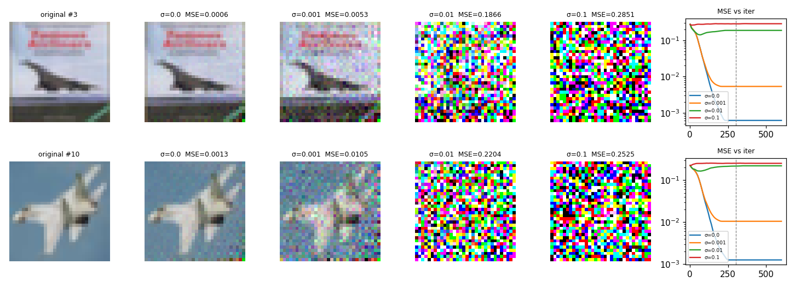

# 배병욱

Flask·REST 연합학습 보안 시뮬레이터(`fedsim`)를 처음부터 새로 작성했습니다. 다른 조원 폴더의 코드는 쓰지 않았고, 학습 설정만 팀에서 맞춘 값(SGD lr 0.01 등)과 공용 분할 파일을 씁니다.

**이 코드에서 새로 다룬 것 (다른 구현과 다른 점)**
1. **원인 분석용 재실행 도구 (6단계)** `fedsim.replay`: 저장된 라운드 모델에서 출발해 *조건 하나만* 바꿔(특정 악성의 조작 해제 / 방어만 교체 / 공격 해제) 다시 돌리고, 원래 결과와의 차이(%p)를 바로 출력합니다.
2. **서버 쪽 방어 진단 로그**: 서버가 악성 ID를 모르는 상태에서 볼 수 있는 값만으로, 업데이트마다 *좌표별 중앙값과의 코사인 유사도*와 *클리핑에 실제로 잘렸는지*를 기록합니다. 비교표에서 정상/악성으로 나눠 "클리핑 상한이 악성만 자르는지", "악성 업데이트가 다수 방향과 얼마나 다른지"를 보여 줍니다.
3. **DLG에서 노이즈 영향과 반복 부족 구분**: 한 실행에서 300회·600회 MSE를 함께 기록해, 반복을 2배로 늘려도 그대로면 "노이즈로 정체", 크게 줄면 "반복 부족"으로 자동 판정합니다 (명세 6단계의 요구).
4. **서버는 평탄화한 가중치 벡터만 다룸**: 모델 구조를 몰라도 집계·검증이 되고, 업데이트 길이 검사로 잘못된 제출을 거릅니다. NaN/Inf 제출과 집계 결과는 서버가 거부해서, 공격으로 발산해도 전역 모델이 망가지지 않고 사유가 남습니다.

## 구현 범위
- 명세 단계: **1~5단계 구현 + 6단계 재실행 도구와 사례 1건.** 비교 실험 24회(시드 0, 20라운드), DLG 8회, 재실행 2회

| 단계 | 구현 | 파일 |
|---|---|---|
| 1 | CIFAR-10 직접 로드(공식 배치 파일), 팀 공용 IID 분할, 클라이언트별 표본 수·클래스 분포 기록 | `fedsim/data.py` |
| 2 | Flask 서버 + 순차 학습 가상 클라이언트 10개, REST로 모델 다운로드·업데이트 제출, 라운드·버전·ID 검증과 12가지 제외 사유 | `fedsim/server.py`, `fedsim/runner.py` |
| 3 | 협력 공격(참여 악성 정상 업데이트 평균 × −5, 1명이면 자기 것 × −5, 0명이면 없음), 노름 클리핑+FedAvg, 좌표별 중앙값(짝수면 가운데 두 값 평균), DLG + 가우시안 노이즈 | `fedsim/attacks.py`, `fedsim/aggregation.py`, `fedsim/dlg.py` |
| 4 | 기준 / 지연(고정 3명, 가상 마감) / 부분 참여(5명) / 레이블 편향(같은 이미지·표본 수, 배정만 변경) | `fedsim/environment.py`, `fedsim/data.py` |
| 5 | rounds·clients·class_acc·client_acc CSV, summary/config/env JSON, 5라운드마다 모델 저장, 비교표 | `fedsim/runner.py`, `fedsim/compare.py` |
| 6 | 체크포인트 재실행 (조건 하나만 변경) | `fedsim/replay.py` |
| 검증 | 집계·방어·공격·서버 검증 수치 예제 17개 | `tests/test_numeric.py` |

## 실행 명령
```bash
cd members/배병욱
pip install -r requirements.txt
# 데이터 (data/README.md)
cd data && curl -LO https://www.cs.toronto.edu/~kriz/cifar-10-python.tar.gz && tar xzf cifar-10-python.tar.gz && rm cifar-10-python.tar.gz && cd ..

python -m unittest tests.test_numeric                                    # 수치 예제 테스트
python -m fedsim.runner --env baseline --attack --defense median --seed 0   # 실험 1회 (서버 자동 실행)
python -m fedsim.run_matrix --envs baseline --seeds 0 --rounds 20         # 일괄 실행 (끝난 것은 건너뜀)
python -m fedsim.compare --dir experiments/matrix                         # 비교표·방어 진단
python -m fedsim.dlg --images 3 10 --sigmas 0 0.01 0.1                    # DLG
python -m fedsim.replay --run experiments/matrix/baseline-attack-fedavg-s0 --from-round 5 --defense median
```
서버만 따로 띄우려면 `python -m fedsim.server --port 5055` 후 `--server http://127.0.0.1:5055`.

### API
| 메서드 | 경로 | 내용 |
|---|---|---|
| POST | `/reset` | 본문: 초기 가중치, `X-Meta`: 집계 방식·클리핑 상한·최소 채택 수·참여 일정 |
| GET | `/status` | 라운드, 모델 버전, 채택·제외 현황 |
| GET | `/model` | 본문: 전역 가중치, 헤더: `X-Round`, `X-Version`, `X-Participants`, `X-Deadline` |
| POST | `/update` | 본문: 업데이트, `X-Meta`: `client_id, round, version, num_samples, virtual_finish` → 채택 또는 제외 사유 |
| POST | `/aggregate` | 채택분 집계. 3개 미만이면 갱신 안 함(`too_few_accepted`). 방어 후 노름·코사인·클리핑 여부 반환 |

제외 사유: `bad_meta, unknown_client, wrong_round, stale_version, not_selected, duplicate, bad_num_samples, bad_payload, bad_shape, non_finite, bad_virtual_finish, late`

## 설정 값
| 항목 | 값 |
|---|---|
| 모델 | `simple_cnn` (합성곱 3층 + 완전연결 2층, BatchNorm 없음) |
| 옵티마이저 | SGD, momentum 0.9, weight_decay 5e-4 |
| 학습률 | 0.01 |
| round | 40 (설정 기본값) / 아래 결과는 20 (`--rounds 20`) |
| local_ep | 1 |
| local_bs | 32 |
| 분할 | 팀 공용 `configs/splits/iid_seed0.json` (클라이언트 10 × 4,500, 검증 5,000), 테스트는 공식 10,000장 |
| 악성 | 2명 (시드로 결정, 환경이 달라도 같음) |
| 클리핑 상한 | 3.0 (기준·정상·FedAvg 20라운드의 정상 업데이트 노름 최대 2.94 바로 위. 모든 비교 실험에서 고정) |
| 지연 | 고정 3명, 가상 완료 시각 1.0~1.2 + 지연 5.0, 마감 3.0 |
| 레이블 편향 | 표본의 80%를 레이블 정렬 조각 2개에서, 20%는 무작위 |
| DLG | LeNet(Sigmoid), L-BFGS lr 1 + strong-Wolfe 선 탐색, 600회(300회 시점 함께 기록), σ 0 / 0.001 / 0.01 / 0.1, 테스트 이미지 #3·#10 |

## 결과
실행 환경: MacBook (Apple MPS), 시드 0, 20라운드. 1라운드 약 7.5초(단독 실행), 실험 1회 약 2.5분.

### 운영 환경별 비교 실험 — 24회 (환경 4 × 정상·공격 × FedAvg·클리핑·중앙값, 시드 0)
최종 테스트 정확도(%). 전체 표·방어 진단: [`experiments/matrix/_tables/comparison.md`](experiments/matrix/_tables/comparison.md)

| 환경 | 정상 FedAvg | 정상 클리핑 | 정상 중앙값 | 공격 FedAvg | 공격 클리핑 | 공격 중앙값 |
|---|---|---|---|---|---|---|
| 기준 | 73.58 | 73.58 | 73.49 | 10.00 (10R 발산) | 64.97 | **68.05** |
| 지연 (3명 제외) | 72.50 | 72.49 | 72.37 | 10.00 (17R 발산) | 58.11 | **61.11** |
| 부분 참여 (5명) | 72.53 | 72.53 | 72.28 | 10.00 (8R 발산) | 65.96 | **67.90** |
| 레이블 편향 | 67.99 | 67.99 | 65.94 | 10.00 (5R 발산) | 44.53 | **53.68** |

| 환경 | 공격 피해 | 방어 개선 (클리핑 / 중앙값) | 정상 손실 (클리핑 / 중앙값) |
|---|---|---|---|
| 기준 | +63.58 | +54.97 / +58.05 | +0.00 / +0.09 |
| 지연 | +62.50 | +48.11 / +51.11 | +0.01 / +0.13 |
| 부분 참여 | +62.53 | +55.96 / +57.90 | +0.00 / +0.25 |
| 레이블 편향 | +57.99 | +34.53 / +43.68 | +0.00 / +2.05 |

- 공격 + FedAvg는 4개 환경 모두 발산 (레이블 편향 5R로 가장 빠름, 지연 17R로 가장 늦음)
- 두 방어 모두 발산은 막지만 정상보다 5~24%p 낮음. 4개 환경 모두 **중앙값 > 클리핑**
- 정상 손실은 클리핑이 거의 0 (상한 3.0이 정상 업데이트를 거의 안 자름), 중앙값은 **레이블 편향에서 2.05%p**로 커짐
- 방어 진단: 클리핑은 악성 업데이트를 100%, 정상은 0~1%만 자름. 공격 + FedAvg에서 악성 업데이트와 중앙값의 코사인은 기준·지연·부분 참여 −0.84~−0.97 (정상 +0.87~+0.98), 레이블 편향 −0.37 (정상 +0.53) → 서버가 악성 ID 없이도 방향으로 구분할 수 있지만, 레이블 편향에서는 정상끼리도 방향이 흩어져 구분이 약해짐 (중앙값 방어가 이 환경에서 손실이 큰 이유의 후보)

### 6단계 재실행 예시 — 기준·공격·FedAvg가 10라운드에 발산한 원인
5라운드 모델(아직 발산 전)에서 출발, 조건 하나만 바꿔 20라운드까지 재실행 (`fedsim.replay`)

| 재실행 | 최종 테스트 | 원래 대비 |
|---|---|---|
| 원래 (악성 4·8번 둘 다 조작) | 10.00 (10R 발산) | – |
| 악성 4번 조작만 해제 | 57.75, 발산 없음 | +47.75%p |
| 방어만 중앙값으로 교체 | 65.83, 발산 없음 | +55.83%p |

- 가설: 악성 2명이 정상 평균 × −5를 내면 FedAvg 결과 ≈ (8 − 10)/10 = 정상 평균 × **−0.2** → 학습 방향이 반대가 되어 손실이 커지다 발산. 1명이면 ≈ (9 − 5)/10 = **+0.4**배라 느려질 뿐 학습은 됨
- 재실행 결과가 가설과 맞음 (1명 해제 → 발산 없음). 한계: 시드 0, 한 출발 라운드만 확인

### 모델 역추적 (DLG) — `experiments/dlg/`
| σ | 이미지 #3 MSE | 이미지 #10 MSE | 판정 |
|---|---|---|---|
| 0 | 0.0006 | 0.0013 | 복원 성공 |
| 0.001 | 0.0053 | 0.0105 | 형태는 보임 |
| 0.01 | 0.187 | 0.220 | 복원 실패 |
| 0.1 | 0.285 | 0.253 | 복원 실패 |

- MSE는 [0,1] 범위로 자른 복원 이미지 기준. 300회와 600회 MSE가 같음 → 실패 원인은 **반복 부족이 아니라 노이즈** (L-BFGS가 노이즈 낀 그래디언트에 맞춰 수렴)
- σ 0.01은 MSE가 60회 근처에서 가장 낮았다가 다시 올라감 → 노이즈에 과적합
- 레이블은 σ 0.1에서도 모두 복원됨 (노이즈로 레이블 유출은 못 막음)
- 원본 DLG 설정(선 탐색 없음)은 σ=0에서도 수십 회 만에 폭주 → `experiments/dlg_original_lbfgs/` (이 폴더의 MSE는 자르기 전 값). 그래서 선 탐색을 기본값으로 바꿈



## 커밋 ID
- 결과를 낸 코드: `432d388` (시뮬레이터), DLG는 `da121b5`
- 실험은 커밋 전에 같은 코드로 돌려서 각 `env.json`의 commit 칸에는 기준 커밋 `751801e`가 찍혀 있습니다. `baseline-normal-fedavg-s0`은 방어 진단 열(코사인·클리핑) 추가 전에 돌린 것이라 그 두 열만 없습니다.

## 공개 코드 출처
- DLG: https://github.com/mit-han-lab/dlg (MIT). 손실 형태(그래디언트 차이 제곱합), L-BFGS, 소프트 레이블, LeNet 구조를 따름. 노이즈 방어·판정·로그는 새로 작성.
- FedAvg: McMahan et al. 2017의 표본 수 가중 평균을 직접 구현 (코드 복사 없음).
