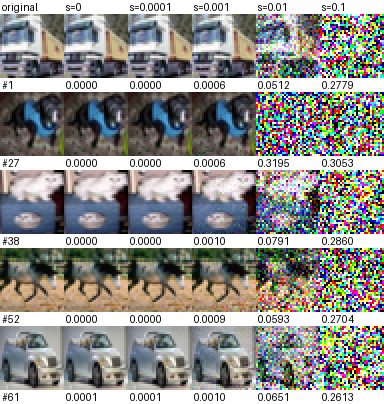
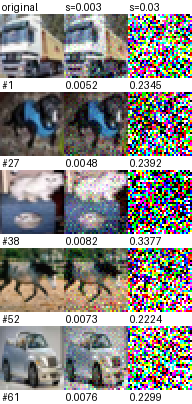

# 모델 역추적(DLG) 결과와 노이즈 수준 제안

- 실험: 2026-11-19, 이승규 (CPU, `scripts/run_dlg.py`)
- 상태: **반영**. 노이즈 없음·작음·큼(σ 0, 1e-2, 1e-1)을 `configs/dlg.yaml`에 넣었다 (11/19). 아래 탐색 범위는 `--sigmas`로 다시 돌릴 수 있다.

---

## 한눈에 보기

**제안하는 노이즈 수준** (σ = 그래디언트 원소마다 더하는 가우시안 노이즈의 표준편차)

| 수준 | σ | 복원 MSE (이미지 5장, 300회) | 눈으로 본 결과 | 근거 |
|---|---|---|---|---|
| 없음 | 0 | 0.000004\~0.00005 | 원본과 구분 안 됨 | 기준 |
| **작음** | **1e-2** | 0.051\~0.079 (dog는 정체. 더미 시드를 바꾸면 0.038\~0.039) | 노이즈가 심하지만 트럭·말·자동차 형체가 남음 | 1e-3까지는 그림이 원본과 같고, 3e-3에서 거칠어지기 시작해 1e-2에서 확실히 나빠짐. "효과는 있지만 충분하지 않은" 수준 |
| **큼** | **1e-1** | 0.26\~0.31 | 색 점뿐, 형체 없음 | 무작위 시작점의 MSE(0.18\~0.27)와 같은 수준 = 복원이 아무것도 얻지 못함. 3e-2부터 이미 형체가 사라지지만 한 자리 여유를 둠 |

**주요 결과**
- 노이즈 없이(σ 0)는 이미지 5장 모두 80\~130회 만에 MSE 0.001 아래로 복원되고, 300회면 MSE 0.00005 이하다. 정답 레이블도 5장 모두 맞힌다.
- σ 1e-3 → 1e-2에서 MSE가 약 80배(평균 0.0008 → 0.064) 커진다. 3e-2부터는 무작위 시작점 수준이다.
- **노이즈는 이미지는 지키지만 레이블은 못 지킨다.** σ 1e-1에서도 레이블은 5장 모두 맞혔다.
- **노이즈 때문인지, 반복이 부족해서인지는 그래디언트 차이로 가린다** (아래 "반복 횟수 궤적 해석"). 노이즈가 있으면 그래디언트 차이가 노이즈 제곱합의 약 0.81배(노이즈 바닥)에서 멈춘다. 여기 도달했으면 최적화는 끝났고 남은 오차는 노이즈 탓이다.
- 노이즈가 있는 조합(이미지 × σ × 더미 시드) 33개 중 2개는 L-BFGS가 처음 몇 걸음에 크게 튀어 멈춰 버렸다(최적화 정체). 같은 조건에서 더미 시작값만 바꾸면 정상 복원된다 → **방어 효과로 세면 안 된다.**
- 실행 시간: CPU 기준 이미지 한 장·300회 약 6\~12초. σ 5개 × 이미지 5장 전체 약 3분.

---

## 조건

| 항목 | 값 |
|---|---|
| 가정 | 서버가 한 클라이언트의 그래디언트를 그대로 본다. 그래디언트는 **이미지 한 장으로 1회** 계산한 것. 연합학습 본 실험과 분리된 소규모 실험 |
| 이미지 | CIFAR-10 학습 이미지, 공용 분할(`configs/splits/iid_seed0.json`) 클라이언트 0의 데이터에서 인덱스 작은 순으로 클래스가 겹치지 않는 앞쪽 5장: **1 truck, 27 dog, 38 cat, 52 horse, 61 automobile**. 픽셀 [0, 1], 정규화 없음 |
| 모델 | DLG 논문의 LeNet (합성곱 3층 + 완전연결 1층, 시그모이드, 파라미터 15,826개). 가중치·편향 U(−0.5, 0.5), 모델 시드 0. 학습하지 않은 상태 |
| 피해자 | 정답 레이블로 교차 엔트로피 그래디언트 계산 → (방어) 노이즈 추가 → 전송 |
| 공격자 | 모델과 받은 그래디언트만 입력. 더미 이미지·soft label을 N(0, 1)에서 시작(더미 시드 0), L-BFGS(lr 1)로 그래디언트 차이 제곱합 최소화. **원본 이미지·정답 레이블은 받지 않음** |
| 평가 | 원본은 여기서만 사용. MSE = 복원 이미지를 [0, 1]로 자른 뒤 픽셀 평균 제곱 오차(주 지표). 자르지 않은 MSE도 기록. 레이블은 더미 soft label의 최댓값 위치와 정답 비교 |
| 반복 | 300회(원 논문 코드와 같음). 반복 1회 = L-BFGS step 1회(내부 함수 평가 최대 20회) |
| 시드 | 모델 0, 더미 0, 노이즈 0. 세 시드가 따로 있어 **노이즈만 바꿔도 모델·더미 시작값은 같다** |
| 기기 | Apple M3 Pro **CPU** (torch 2.15.0, 스레드 5). 같은 설정을 다시 돌리면 MSE가 소수점 끝까지 같음을 확인 |

**표에 나오는 용어**

| 용어 | 뜻 |
|---|---|
| 그래디언트 차이 | 받은 그래디언트와 더미로 계산한 그래디언트의 차이 제곱합. 공격자가 최소화하는 값이며 공격자도 볼 수 있다 |
| 노이즈 제곱합 | 실제로 더한 노이즈의 제곱합 ≈ σ² × 15,826. 평가용(공격자는 모름) |
| 노이즈 바닥 비율 | 그래디언트 차이 ÷ 노이즈 제곱합. **약 0.81이면 수렴, 1보다 훨씬 크면 아직 덜 됐거나 정체** |
| 최대 픽셀 | 자르지 않은 복원 이미지의 최대 절댓값. 1을 크게 넘으면(수만 이상) 픽셀이 폭주해 시그모이드가 포화된 것 |

---

## 결과

### 실험 1. σ 탐색 (`experiments/dlg/sweep_sigma/`, 300회)

| σ | truck (1) | dog (27) | cat (38) | horse (52) | automobile (61) | 레이블 |
|---|---|---|---|---|---|---|
| 0 | 0.000008 | 0.000005 | 0.000004 | 0.000010 | 0.000054 | 5/5 |
| 1e-4 | 0.000010 | 0.000014 | 0.000011 | 0.000017 | 0.000098 | 5/5 |
| 1e-3 | 0.00060 | 0.00056 | 0.00096 | 0.00085 | 0.00102 | 5/5 |
| 1e-2 | 0.0512 | *0.3195 (정체)* | 0.0791 | 0.0593 | 0.0651 | 5/5 |
| 1e-1 | 0.278 | 0.305 | 0.286 | 0.270 | 0.261 | 5/5 |
| (참고) 시작점 | 0.252 | 0.180 | 0.265 | 0.222 | 0.244 | |

(그림: 줄마다 이미지 한 장. 원본 | σ 0, 1e-4, 1e-3, 1e-2, 1e-1. 칸 아래 숫자는 MSE)

### 실험 2. 중간 σ 보강 (`experiments/dlg/refine_sigma/`, 300회)
"나빠지기 시작하는 값"과 "형체가 사라지는 값"의 경계를 좁히려고 3e-3, 3e-2를 추가했다.

| σ | MSE (5장) | 눈으로 본 결과 | 레이블 |
|---|---|---|---|
| 3e-3 | 0.0048\~0.0082 | 형체 뚜렷, cat 등에서 알갱이가 보이기 시작 | 5/5 |
| 3e-2 | 0.222\~0.239, *cat 0.338 (정체)* | 형체 없음. 이미 시작점 수준 | 4/5 (정체한 cat만 틀림) |

### 실험 3. 반복 횟수만 바꾸기 (`experiments/dlg/iterations/`, σ 0·1e-3·1e-2 × 50·1000회)
같은 이미지·모델·더미 시작값에서 반복 횟수만 바꿨다. 50·300회 지점의 MSE는 300회 실행(실험 1)의 같은 지점과 45개 모두 같다 → 반복 횟수가 다른 실행끼리 그대로 비교할 수 있다.

| σ | 50회 MSE | 300회 MSE | 1000회 MSE | 해석 |
|---|---|---|---|---|
| 0 | 0.008\~0.025 | ≤ 0.00005 | 300회와 같음 | 50회는 **덜 된 것**. 반복을 늘리면 거의 0 |
| 1e-3 | 0.006\~0.028 | 0.0006\~0.0010 | 300회와 같음 | 50회는 덜 됨(바닥 비율 0.96\~1.82). 300회에 바닥(0.81) 도달 |
| 1e-2 | 0.039\~0.057 (dog 정체 제외) | 0.051\~0.079 | 0.051\~0.080 | 50회에 이미 바닥 도달. 반복을 늘리면 **오히려 나빠짐** |

### 실험 4. 정체 사례 재실험 (`experiments/dlg/dog_sigma0.01_dummy{1,2,3}/`)
dog σ 1e-2(더미 시드 0)는 MSE 0.32로 σ 1e-1보다도 나빴다. 같은 이미지·모델·노이즈에서 **더미 시드만** 1, 2, 3으로 바꿔 다시 돌렸다.

| 더미 시드 | MSE | 그래디언트 차이 | 노이즈 바닥 비율 | 최대 픽셀 |
|---|---|---|---|---|
| 0 (실험 1) | 0.3195 | 465 | 292 | 5.5 × 10⁷ |
| 1 | 0.0392 | 1.28 | 0.807 | 2.1 |
| 2 | 0.0387 | 1.28 | 0.807 | 3.0 |
| 3 | 0.0380 | 1.28 | 0.807 | 2.6 |

→ 노이즈가 강해서가 아니라, 시드 0의 시작점에서 L-BFGS가 처음 10회 안에 큰 걸음을 내디뎌 픽셀이 10⁷까지 튀고 시그모이드가 포화돼 기울기가 사라진 것이다. 시드를 바꾸면 다른 이미지들과 같은 수준(0.04)으로 복원된다. 반복을 50 → 1000회로 늘려도 0.3195 그대로다(실험 3).

---

## 반복 횟수 궤적 해석 (덜 된 복원과 노이즈 효과 구분)

truck(1)의 궤적 (`experiments/dlg/iterations/trajectory.csv`, 1000회 실행. 그래디언트 차이 / MSE)

| 반복 | σ 0 | σ 1e-3 | σ 1e-2 |
|---|---|---|---|
| 0 | 512 / 0.252 | 512 / 0.252 | 514 / 0.252 |
| 10 | 3.38 / 0.163 | 3.66 / 0.165 | 4.72 / 0.163 |
| 30 | 0.076 / 0.055 | 0.094 / 0.056 | 1.38 / 0.065 |
| 50 | 0.0039 / 0.0089 | 0.018 / 0.011 | 1.30 / **0.039** |
| 100 | 0.00004 / 0.0002 | 0.013 / 0.0008 | 1.29 / 0.050 |
| 300 | 0.000002 / 0.000008 | 0.0129 / 0.0006 | 1.29 / 0.051 |
| 1000 | 0.000002 / 0.000008 | 0.0129 / 0.0006 | 1.29 / 0.051 |
| 노이즈 바닥 (노이즈 제곱합 × 0.81) | 0 | 0.0129 | 1.29 |

**판정 규칙 (제안)**
1. **노이즈 바닥 비율이 1보다 확실히 크면(예: 1.1 이상) "덜 된 복원"이다.** 반복을 늘리면 MSE가 더 내려간다. 예: σ 1e-3의 50회(비율 0.96\~1.82, MSE 0.006\~0.028 → 300회 0.0006\~0.0010). σ 0이면 비율 대신 그래디언트 차이 자체가 0으로 가는지 본다.
2. **비율이 약 0.81에서 멈췄으면 "노이즈 때문"이다.** 반복을 늘려도 MSE가 줄지 않는다. 예: σ 1e-2의 300회와 1000회 MSE가 같다.
3. **비율이 수십\~수백이고 최대 픽셀이 폭주했으면 "최적화 정체"다.** 반복을 늘려도 그대로다. 더미 시드를 바꿔 다시 돌려 확인한다(실험 4).

**왜 0.81인가 (가설):** 공격자가 바꿀 수 있는 값은 더미 이미지 3,072개 + soft label 10개 = 3,082개이고, 그래디언트는 15,826개다. 더미가 노이즈 중 약 3,082 / 15,826 ≈ 19% 방향만 흡수할 수 있어 나머지 약 81%가 남는다고 보면 측정값(0.80\~0.85)과 맞는다. 노이즈 일부를 흡수한다는 것은 더미가 노이즈에 맞춰진다는 뜻이고, σ 1e-2에서 MSE가 50회 0.039 → 1000회 0.051로 **오히려 커지는** 것도 이것으로 설명된다. 이론 계산이 아니라 측정값과의 일치이므로 가설로 둔다.

**6단계 원인 분석 사례 후보:** "dog σ 1e-2의 복원 실패는 노이즈 때문인가?" → 관찰(MSE 0.32, σ 1e-1보다 나쁨) → 가설(최적화 정체: 비율 292, 최대 픽셀 5.5×10⁷) → 재실험(더미 시드만 변경, 반복 횟수만 변경) → 결과(시드 변경 시 0.04로 회복, 반복 증가로는 변화 없음) → 한계(시드 3개, 이미지 1장).

---

## 공개 코드 출처와 달라진 점

- 출처: Zhu, Liu, Han, "Deep Leakage from Gradients", NeurIPS 2019. 공개 코드 https://github.com/mit-han-lab/dlg (`main.py`, `models/vision.py`)
- 코드를 복사하지 않고 같은 구성으로 새로 작성했다: `src/fedsec/models/lenet.py`, `src/fedsec/attacks/dlg.py`

| 항목 | 원 코드 | 이 구현 |
|---|---|---|
| 데이터 | CIFAR-100, 명령줄로 이미지 1장 (기본 25번) | CIFAR-10, 공용 분할 클라이언트 0의 5장 (설정 파일에 고정) |
| 모델 출력 | 100 클래스 | 10 클래스 (나머지 구조·시그모이드·U(−0.5, 0.5) 초기화는 같음) |
| 시드 | 전역 `torch.manual_seed` 하나 | 모델·더미·노이즈 시드를 각각 전용 Generator로 분리 |
| 더미·최적화 | N(0, 1) 더미 이미지·soft label, L-BFGS 기본값(lr 1), 300회 | 같음 |
| 그래디언트 계산 | `grad_diff.backward()` (모델 파라미터 `.grad`에도 쌓임) | `autograd.grad`로 더미에만 넣음 (모델 상태를 건드리지 않음) |
| 노이즈 방어 | 공개 코드에는 없음 (논문 실험에만 있음) | `add_gaussian_noise`: 전송 전 그래디언트에 N(0, σ²) 추가. 입력은 바꾸지 않음 |
| 공격 입력 분리 | 한 스크립트 안에서 원본과 함께 처리 | 복원 함수는 모델·그래디언트·모양·반복·더미 시드만 받음. 원본·레이블은 평가 함수에만 |
| 기록 | 10회마다 그래디언트 차이 출력, 이미지 표시 | 10회마다 그래디언트 차이와 MSE(자른 값·자르지 않은 값) CSV, 복원 PNG, 비교 그림, 실행 환경 |
| 발산 처리 | 없음 | 그래디언트 차이가 NaN·무한대면 멈추고 `diverged` 표시. 정체는 `max_abs_pixel`, `grad_diff_over_noise` 열로 확인 |
| 기기 | GPU가 있으면 GPU | CPU 고정 |

---

## 한계
- **규모:** 이미지 5장, 모델 초기값 1개(시드 0), 노이즈 시드 1개. 정체 사례 재실험은 이미지 1장 × 더미 시드 3개.
- **노이즈·더미 시작값이 하나씩:** 노이즈 시드 하나(0)를 모든 이미지와 σ에 같이 쓴다. 즉 같은 표준정규 표본을 σ배 해서 더하므로, σ끼리의 비교는 서로 독립인 측정이 아니다. 더미 시작값도 하나(시드 0)라 표의 MSE는 평균이 아니라 한 번 돌린 값이다. 이 흔들림은 작지 않다: dog σ 1e-2는 더미 시드 0에서 0.32(σ 1e-1 수준)였지만 시드만 바꾸면 0.04였다. 그래서 σ 비교는 정체 사례를 빼고 보고, 비슷한 σ끼리의 작은 차이는 해석하지 않는다.
- **정체 처리:** 정체 2건(dog σ 1e-2, cat σ 3e-2)은 표에 그대로 두었다. 공격자도 그래디언트 차이를 볼 수 있으므로, 더미 시드 몇 개로 돌려 그래디언트 차이가 가장 작은 것을 고르는 방식이 공정한 비교가 될 수 있다(아직 구현하지 않음, 팀 결정 필요).
- **모델:** 학습하지 않은(초기값) LeNet 하나에서 이미지 한 장의 그래디언트를 썼다. 학습된 모델, 배치 여러 장, 여러 번 로컬 학습한 업데이트(FedAvg 본 실험의 실제 전송값)에서는 복원이 더 어렵다.
- **σ의 의미:** σ는 이 LeNet의 단일 이미지 그래디언트 크기(제곱합 760\~1,008, 노름 약 28\~32)에 대한 값이다. 노이즈 노름은 σ × 126이라 σ 1e-2는 그래디언트 노름의 약 4%, 1e-1은 약 40%다. 본 실험의 SimpleCNN 업데이트에 같은 σ를 그대로 옮기면 의미가 다르다.
- **레이블:** σ 1e-1에서도 레이블이 새어 나간다. 레이블을 지키려면 다른 방어가 필요하다.
- **정확도 손실 미측정:** 이 실험은 복원만 본다. 노이즈가 학습 정확도에 주는 손실은 재지 않았다.
- **코드 상태:** 모든 실행의 `env.json`은 `dirty: true`다(커밋 `e1022ca` 위에서 아직 커밋하지 않은 코드로 실행).

## 결과 파일
| 실험 | 결과 폴더 (`members/이승규/` 기준) | 다시 실행하는 명령 (새 폴더 `*_rerun`) |
|---|---|---|
| 1 | `experiments/dlg/sweep_sigma/` | `python scripts/run_dlg.py --name sweep_sigma_rerun --sigmas 0 1e-4 1e-3 1e-2 1e-1` |
| 2 | `experiments/dlg/refine_sigma/` | `python scripts/run_dlg.py --name refine_sigma_rerun --sigmas 0.003 0.03` |
| 3 | `experiments/dlg/iterations/` | `python scripts/run_dlg.py --name iterations_rerun --sigmas 0 0.001 0.01 --iterations 50 1000` |
| 4 | `experiments/dlg/dog_sigma0.01_dummy{1,2,3}/` | `python scripts/run_dlg.py --name dog_sigma0.01_dummy1_rerun --images 27 --sigmas 0.01 --dummy-seed 1` (2, 3도 같은 방식) |

- 다시 실행할 때 기준은 각 폴더의 `config.yaml`이다. `configs/dlg.yaml` 기본값은 실험 뒤 σ 3개로 바뀌었으므로, 위 명령처럼 당시 값을 옵션으로 준다
- 기존 폴더는 그대로 두고 `*_rerun` 폴더에 새로 만든다 (같은 이름이면 `run_dlg.py`가 멈춤). 두 폴더의 `results.csv`를 비교하면 재현 여부를 확인할 수 있다
- 폴더마다 `config.yaml`(실제로 쓴 설정), `env.json`, `results.csv`(조합당 1줄), `trajectory.csv`(10회마다), `summary.png`(원본 | σ별 복원). 복원 PNG는 `dlg_images/`(git 무시)
- `results.csv` 열: `image_index, label, class, sigma, grad_sq_norm, iterations, iterations_done, diverged, mse, mse_unclipped, max_abs_pixel, grad_diff, noise_sq_norm, grad_diff_over_noise, pred_label, label_correct, seconds`
